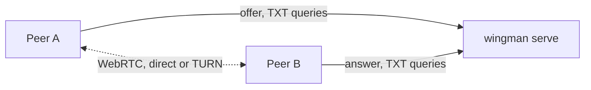

<p align="center">
  
</p>

<p align="center"><b>WebRTC / NAT-traversal signaling over DNS.</b> DNS carries the handshake, then the peers talk directly.</p>

<p align="center">
  <a href="https://github.com/Crank-Git/wingman/actions/workflows/ci.yml"></a>
  
</p>

<p align="center">
  <a href="docs/manual/README.md"><b>Docs</b></a> ·
  <a href="#install"><b>Install</b></a> ·
  <a href="#quick-start"><b>Quick start</b></a>
</p>



## Why wingman

DNS is often the last protocol a network lets out. WebRTC already knows how to punch
through NAT once two peers have swapped SDP; the problem is getting that offer and answer
across in the first place. Wingman uses DNS for that handshake and nothing else. Once ICE
completes, DNS is out of the data path.

Peer A fragments its SDP offer and publishes each fragment as a DNS query under a
rendezvous name, `<room>.<seq>-<total>.<payload>.offer.sig.<zone>`. Peer B polls for it,
reassembles it, and publishes its answer the same way. From there the peers connect
directly, or through TURN when NAT won't allow it.

The hard part is size. A real SDP offer is a few KB and a label holds 63 octets, so the
SDP gets split into base32 fragments, one per label, with a CRC32 trailer on the last one
so reassembly catches corruption. Where a firewall drops unsolicited DNS queries, the same
rooms work over HTTPS instead, and an RFC 2136 backend lets the rooms live on a real
authoritative server.

## Requirements

- **Go 1.25.0**, to build the CLI.
- **Python 3**, for `scripts/demo.sh`.
- **Direct UDP and TCP reachability** from both peers to the server. Peers query the
  server's address directly; recursive resolvers aren't supported.
- **Linux and a Docker daemon**, only for the isolated namespace acceptance test.

## Install

There are no prebuilt releases yet. Build from source:

```sh
git clone https://github.com/Crank-Git/wingman.git
cd wingman
go build -o ./wingman ./cmd/wingman
```

## Quick start

The demo script builds a temporary binary, starts an authenticated DNS server on an
ephemeral loopback port, and runs two peers that swap a message each:

```sh
bash scripts/demo.sh
```

Each peer prints the selected candidate pair, `connected`, and the other peer's text. The
run ends with:

```text
selected pair: local=host remote=host
answer: connected
answer: received "demo message from offer"
demo: both peers receive known text; temporary credentials and children are removed
```

Exit status 0 means the exchange completed. The script deletes its temporary TSIG key and
stops every child process, even on Ctrl-C.

To drive it yourself, start an unauthenticated loopback server:

```sh
./wingman serve --local-demo
```

```text
wingman server listening on 127.0.0.1:50094 (zone "example.com")
```

The port changes every run. Then run each peer in its own terminal, with that port:

```sh
./wingman offer  --addr 127.0.0.1:PORT --zone example.com --room demo
./wingman answer --addr 127.0.0.1:PORT --zone example.com --room demo
```

Wait for both to print `connected`, then type. Use a fresh room for each exchange.

## Usage

| Command | What it does |
|---|---|
| `wingman serve` | Runs the signaling server: DNS on `--listen`, plus optional HTTPS with `--https-listen`. |
| `wingman offer`, `wingman answer` | Runs one side of the exchange, then carries text over the data channel. |
| `wingman doctor` | Probes the selected signaling endpoint in a disposable room and reports each stage. Add `--json` for machine-readable output. |
| `wingman cleanup` | Deletes one DynUpdate room's offer and answer records. |

Pick the signaling transport with `--signaling dns` (the default), `--signaling https`, or
`--signaling dynupdate`. Add `--turn` (repeatable) with `--user` and `--pass-file` when
the peers need a relay.

Any listener that isn't on loopback needs a TSIG key (`--dns-tsig-key-file`) on the server
and both peers. Every flag, the HTTPS listener, doctor's report format, and TURN are in the
[reference](docs/reference.md).

## Documentation

| Page | What's there |
|---|---|
| [User manual](docs/manual/README.md) | Reviewed walkthroughs: the first local exchange, doctor, HTTPS, DynUpdate, a TURN relay, and health checks. |
| [Deployment guide](docs/deployment.md) | Restricted credentials, authenticated DNS across hosts, HTTPS fallback, TURN and firewall ports, and the namespace acceptance test. |
| [Reference](docs/reference.md) | Server configuration, the three transports, the handshake timeout, doctor, TURN and STUN, and metrics. |
| [DynUpdate configuration](docs/dynupdate.md) | The RFC 2136 backend and its authoritative server setup. |
| [DNS authentication](docs/dns-authentication.md) | The TSIG key file. |
| [CONTRIBUTING.md](CONTRIBUTING.md) | Tools, verification, branches, and the package layout. |

## Development

```bash
bash scripts/verify.sh
```

This runs format, complexity, vet, the race detector, the CLI build, and a 95% statement
coverage gate. The race detector needs a C compiler with CGO. Tool setup and the branch
model are in [CONTRIBUTING.md](CONTRIBUTING.md).

## Security

TSIG authenticates DNS messages; it doesn't encrypt SDP. Anyone on the path to the server
can read the offer and answer, including candidate addresses. Use the HTTPS transport if
that matters to you. Credential files must be regular files that only their owner can
read, or Wingman refuses them.

---

<sub>Part of <a href="https://github.com/Crank-Git#things-over-port-53"><b>Things over port 53</b></a>,
my experiments in what else DNS can carry.
Siblings: <a href="https://github.com/Crank-Git/epochalypse">epochalypse</a> ·
<a href="https://github.com/Crank-Git/mcport53">mcport53</a> ·
<a href="https://github.com/Crank-Git/cachemoney">cachemoney</a> ·
<a href="https://github.com/Crank-Git/llamaoverdns">llamaoverdns</a> ·
<a href="https://github.com/Crank-Git/dnscalc">dnscalc</a> ·
Built by <a href="https://github.com/Crank-Git">Crank</a></sub>
