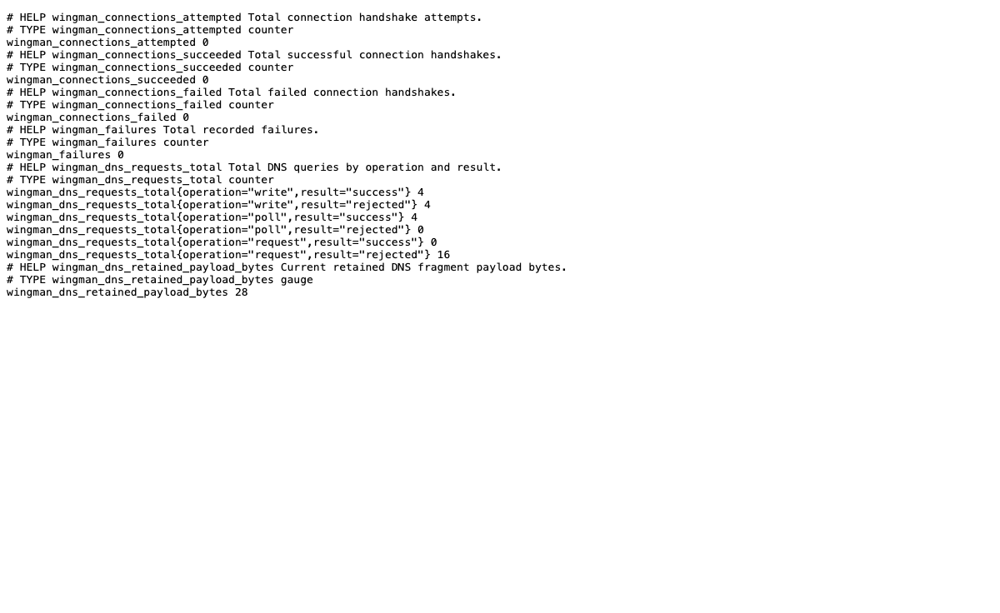

# Check service health and metrics

Use the address printed after successful startup. The examples use a loopback metrics listener. Replace `METRICS_PORT` with your configured port.

1. Open `http://127.0.0.1:METRICS_PORT/healthz`.

   After startup, the endpoint returns HTTP 200 with an empty body. The browser shows a blank page.

   

2. Open `http://127.0.0.1:METRICS_PORT/readyz`.

   After startup, the endpoint returns HTTP 200 with an empty body.

   

3. Open `http://127.0.0.1:METRICS_PORT/metrics`.

   The endpoint returns Prometheus text with DNS operation counters and retained payload bytes.

   

4. Run an authenticated probe:

   ```sh
   wingman doctor --signaling dns --addr HOST:PORT --zone ZONE --dns-tsig-key-file KEY_FILE --json
   ```

5. Refresh `/metrics`.

   The review observes the successful write and poll counters change from 3 to 4. Labels contain operation and result values. Room names and credential values do not appear.

6. To stop a server that you own, press Ctrl-C in its terminal.

   The review's separate server exits 0 after SIGTERM. Its DNS and metrics ports accept new binds afterward.

> **Known limitation:** The review does not observe `/readyz` return 503 during shutdown before listener closure. That transition remains unverified.

The review confirms that unsigned requests and wrong-key requests cannot publish or retrieve authenticated DNS data. Wrong-zone probes also fail. An occupied DNS port prevents a successful startup notice. These checks do not establish a separate-host deployment.
