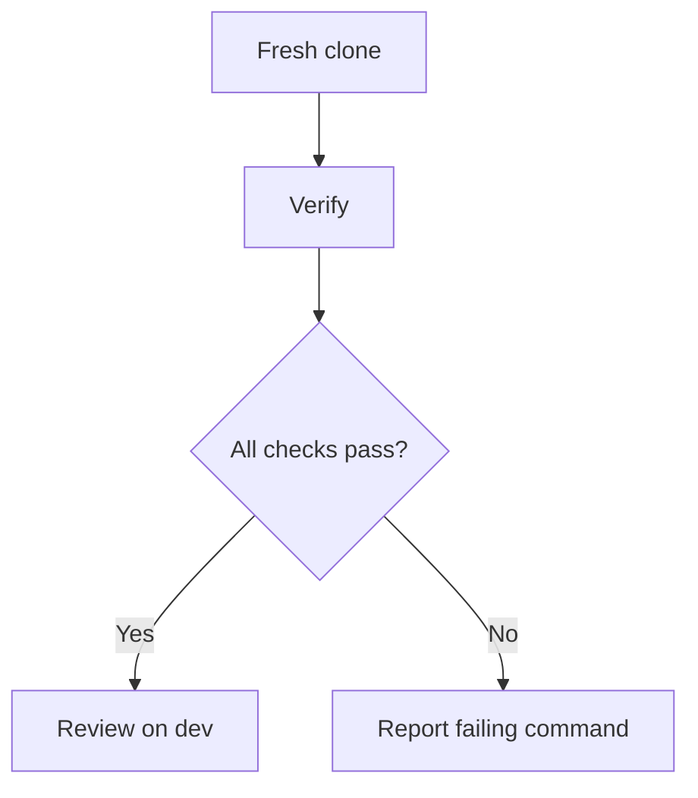

# Foundation gaps

## Purpose
Extend the existing checks with concurrency, format, complexity, reproducibility, and release checks. Preserve the working harness.

## User stories
As a contributor, I want a reproducible verification command so that repairs remain reliable.

## Functional requirements
- FR-foundation-1 — CI runs the race detector on all packages.
- FR-foundation-2 — CI rejects source that fails gofmt.
- FR-foundation-3 — CI enforces a cyclomatic complexity limit of 20 for new functions.
- FR-foundation-4 — The coverage command leaves go.mod and go.sum unchanged.
- FR-foundation-5 — The release guide defines dev integration and approved main promotion.

- FR-foundation-6 — StubTransport synchronizes publication and retrieval.

## User flows

1. Clone the repository.
2. Run the documented verification command.
3. Review failures before a merge to dev.

## Screens & states
The terminal shows each check and its result. Missing tools show an install command. CI failures identify the failing stage.

[Terminal mockup](../mockups/00-foundation.html). The mockup illustrates intent. Requirements define the contract.

## Behaviour rules
Keep the 95% aggregate coverage threshold. Pin the Go toolchain in CI to the module version.
Use a pinned complexity tool. Record existing violations individually; new functions receive no blanket exemption.
The local demo already exists through serve, offer, and answer. No framework bootstrap or database seed is needed.

## Data touched
CI workflow, coverage script, tool configuration, and release documentation.
StubTransport adds a mutex and copies message bytes at its boundaries.
The existing peer tests concurrently publish and poll its map at `internal/sig/transport.go:31-37`.

## Interfaces
Existing baseline: `bash scripts/coverage.sh`; build: `go build ./cmd/wingman`; race: `go test -race ./...`.
The foundation introduces `scripts/verify.sh` as the single verification entry point.
The release guide requires `dev` PRs, required CI, and an explicit approval before `main` promotion.
Branch protection remains an operator action; document the exact required check names.

## Edge cases & failures
Fail on missing required CI tools. Use a writable GOCACHE in restricted environments.
No hosted target exists in the inventory. Release checks build the CLI; they do not imply a deployment.

## Acceptance criteria
- [ ] FR-foundation-1: A deliberately introduced race fails CI.
- [ ] FR-foundation-2: An unformatted fixture fails the format check.
- [ ] FR-foundation-3: A new function above the limit fails the complexity check.
- [ ] FR-foundation-4: Verification produces no module-file diff.
- [ ] FR-foundation-5: The guide identifies dev as integration and main as the approved release branch.

- [ ] FR-foundation-6: The existing peer tests pass the race detector with a shared StubTransport.

## Out of scope
No replacement test harness, repository initialization, automatic main promotion, or cloud account setup.

## Open questions
None.
