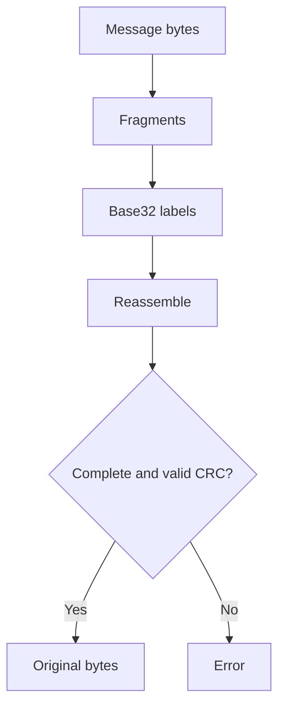

# Signal framing and names

## Purpose
Encode SDP bytes into DNS labels with sequence metadata and a checksum.

## User stories
As a developer, I want deterministic message reconstruction so that DNS can carry the handshake.

## Functional requirements
- FR-framing-1 — Fragments divides message bytes into sequence-numbered fragments.
- FR-framing-2 — The final fragment carries a CRC32 trailer.
- FR-framing-3 — Reassemble restores ordered fragments after checksum validation.
- FR-framing-4 — Naming helpers encode offer or answer beneath the sig label.

## User flows

1. Split the message.
2. Encode each fragment.
3. Reassemble the received fragments.
4. Return bytes or a validation error.

## Screens & states
No screen. Modules: `internal/sig/chunk.go`, `label.go`, and `naming.go`. Errors represent incomplete or corrupt data.

## Behaviour rules
Labels use the DNS-safe base32 representation. A label holds at most 63 octets.
Kind accepts offer and answer. CRC32 detects corruption; it does not authenticate the peer.
Helpers do not comprehensively validate room, zone, or complete DNS wire-name length.

## Data touched
Fragment fields: Seq uint16, Total uint16, Data []byte. ParsedName adds Zone, Room, Kind, and Payload.
These values live in memory; the module performs no persistent writes.

## Interfaces
`Fragments`, `Reassemble`, `EncodeLabel`, `DecodeLabel`, `RendezvousName`, `PollName`, and `ParseRendezvousName`.
See `internal/sig/chunk.go:42`, `internal/sig/naming.go:49`, and `internal/sig/transport.go:9`.
Transport exposes `Publish(ctx, room, kind, msg) error` and `Poll(ctx, room, kind) ([]byte, error)`.

## Edge cases & failures
Reassembly rejects incomplete messages and checksum failures. Naming errors return Go errors.
A room must be a single label in practice, but current helpers do not enforce this consistently.

## Acceptance criteria
- [ ] FR-framing-1: Existing fragment tests recover the input bytes.
- [ ] FR-framing-2: CRC tests reject modified final data.
- [ ] FR-framing-3: Out-of-order tests recover bytes after sequence ordering.
- [ ] FR-framing-4: Naming tests distinguish offer from answer.

## Out of scope
No browser interface or media call support.

## Open questions
None.
