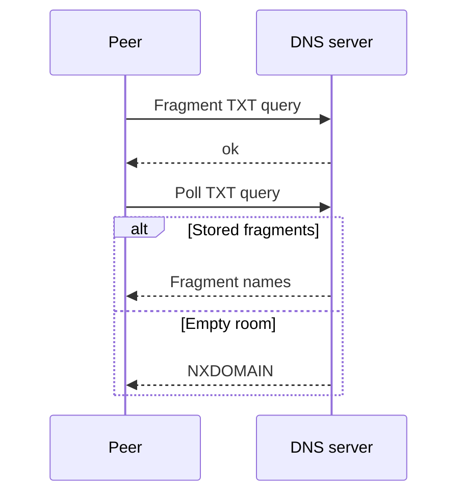

# DNS query transport

## Purpose
Exchange signaling fragments through the custom DNS server.

## User stories
As a peer, I want Publish and Poll over DNS so that I can exchange SDP.

## Functional requirements
- FR-dns-existing-1 — Publish sends each fragment as a TXT query.
- FR-dns-existing-2 — The server stores fragments by room and kind.
- FR-dns-existing-3 — Poll retrieves fragments as TXT answers.
- FR-dns-existing-4 — The Dialer retries a truncated UDP response over TCP.

## User flows

1. Publish fragment queries.
2. Wait for the other peer to publish.
3. Poll the room.
4. Reassemble the returned fragments.

## Screens & states
`wingman serve` prints a loopback address. Peers show connection progress or a transport error.
Source: `internal/dns/server.go`, `transport.go`, and `client.go`.

## Behaviour rules
The server binds loopback UDP and TCP on an ephemeral port. EDNS advertises 4096 bytes.
The library defaults to a 250 ms poll interval. The CLI uses 50 ms.
Zero PollRetries means no retry limit; context cancellation still applies.
The storage key omits zone. The server has no authentication, capacity limit, or expiry.

## Data touched
Server.frags maps room/kind to sequence-indexed Fragment values. A duplicate sequence overwrites the previous fragment.
Stop closes listeners. No persistence or durable room lifecycle exists.

## Interfaces
Writes use `<room>.<seq>-<total>.<payload>.<kind>.sig.<zone>`. Poll uses `<room>.<kind>.sig.<zone>`.
Successful writes return TXT ok. Empty polls return NXDOMAIN. Invalid payload returns FORMERR.
Evidence: `internal/dns/server.go:77-176`, `internal/dns/transport.go:49-165`.
External dependency: [miekg/dns v1.1.73](https://pkg.go.dev/github.com/miekg/dns@v1.1.73).

## Edge cases & failures
Poll retries incomplete messages. CRC failures return an error.
The client does not bind fragment identity to the requested room, kind, and zone.
The server does not enforce query type or class. No SOA establishes the documented negative-cache policy.

## Acceptance criteria
- [ ] FR-dns-existing-1: Existing transport tests observe one query per fragment.
- [ ] FR-dns-existing-2: Server tests retrieve stored fragments.
- [ ] FR-dns-existing-3: Roundtrip tests recover the published message.
- [ ] FR-dns-existing-4: TCP fallback tests complete a large response.

## Out of scope
No browser interface or media call support.

## Open questions
None.
