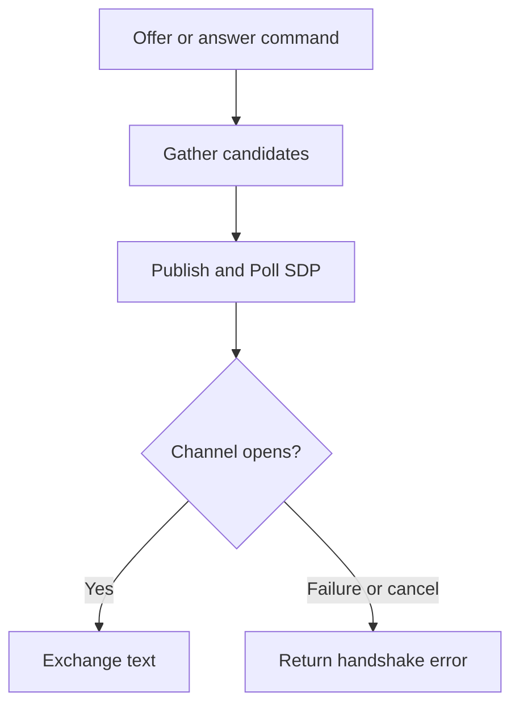

# Peer handshake and chat

## Purpose
Create a Pion WebRTC data channel after a full SDP exchange.

## User stories
As a CLI user, I want to exchange text with another peer after the handshake.

## Functional requirements
- FR-peer-existing-1 — The offerer publishes a complete SDP offer.
- FR-peer-existing-2 — The answerer publishes a complete SDP answer.
- FR-peer-existing-3 — Start returns after the data channel opens.
- FR-peer-existing-4 — The CLI sends stdin lines through the data channel.

## User flows

1. Start serve.
2. Start offer with the printed address.
3. Start answer with the same room.
4. Exchange text after the data channel opens.

## Screens & states
CLI entry points: `cmd/wingman/main.go:83-89`. Session implementation: `internal/peer/session.go`.
No browser screens exist. Peers print incoming messages and handshake errors.

## Behaviour rules
Both peers use one room. Label defaults to wingman. Candidate collection completes before SDP publication.
Pion owns the actual ICE negotiation. The separate internal/ice utilities do not drive Pion candidate allocation.
The session has no public Close method. Invalid roles have no explicit rejection path.

## Data touched
Session owns Config, role, label, peer connection, data channel, handlers, metrics pointer, and openCh.
Serialization stores the Pion session description in a message. No database exists.

## Interfaces
`NewSession`, `Start`, `OnMessage`, `WithMetrics`, `DataChannel`, and `SendText`.
Shared CLI flags include addr, room, zone, label, signaling, signaling-url, signaling-secret, turn, user, pass, and metrics.
External dependency: [Pion WebRTC v4.2.26](https://pkg.go.dev/github.com/pion/webrtc/v4@v4.2.26).

## Edge cases & failures
Transport, SDP, and connection failures return Go errors. Cancellation closes a failed handshake.
WithMetrics writes under a lock; the ICE callback reads the pointer without that lock.
Tests do not establish repeated Start or post-success cleanup guarantees.

## Acceptance criteria
- [ ] FR-peer-existing-1: The offer test publishes an offer.
- [ ] FR-peer-existing-2: The answer test publishes an answer.
- [ ] FR-peer-existing-3: The integration test observes an open channel.
- [ ] FR-peer-existing-4: The local roundtrip test receives a data-channel message.

## Out of scope
No browser interface or media call support.

## Open questions
None.
