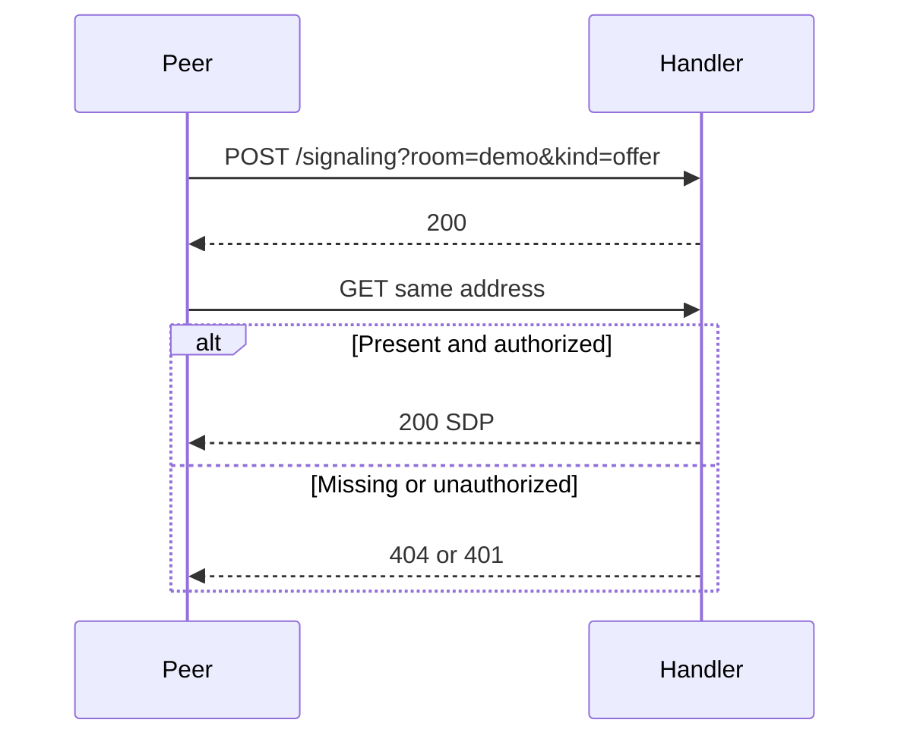

# HTTPS fallback transport

## Purpose
Carry the complete SDP through a small HTTP handler.

## User stories
As a developer, I want a fallback transport behind the same Publish and Poll contract.

## Functional requirements
- FR-https-existing-1 — POST stores a message for a room and kind.
- FR-https-existing-2 — GET returns a stored message.
- FR-https-existing-3 — A configured Secret requires the X-Wingman-Secret header.
- FR-https-existing-4 — The handler sweeps expired entries on access.

## User flows

1. Publish a message.
2. Poll the same room and kind.
3. Receive the message or retry a miss.

## Screens & states
No bundled HTTPS server command exists. Developers mount `internal/https.Handler`.
CLI peers select `--signaling https --signaling-url URL`. Errors print to stderr.

## Behaviour rules
POST replaces the entry. GET writes the entry before deletion. Concurrent GET and POST can violate one-shot behavior.
The handler accepts unbounded bodies and room values. It has no capacity limit.
TTL sweep runs on access. It does not provide an absolute memory bound.
The transport accepts HTTP URLs even though the option describes HTTPS.

## Data touched
Handler.msgs maps room/kind to entry{data []byte, at time.Time}. NewHandler initializes the map and default TTL.
Secret is server-wide. Empty Secret permits access without credentials.

## Interfaces
`POST /signaling?room=ROOM&kind=offer|answer`: body is the complete serialized SDP. Success returns 200.
`GET` returns 200 application/sdp or 404. Invalid parameters return 400. Wrong secret returns 401. Unsupported method returns 405.
Evidence: `internal/https/https.go:190-295`. Transport implements sig.Transport.

## Edge cases & failures
Client cancellation bounds Poll. The handler reports read errors as 400.
The handler provides no TLS listener itself. A mount point must provide TLS.
One successful GET can delete a newer POST because deletion occurs after the body write.

## Acceptance criteria
- [ ] FR-https-existing-1: POST/GET tests recover the exact bytes.
- [ ] FR-https-existing-2: A missing entry returns 404.
- [ ] FR-https-existing-3: The wrong secret returns 401.
- [ ] FR-https-existing-4: Expiry tests remove old entries during a sweep.

## Out of scope
No browser interface or media call support.

## Open questions
None.
