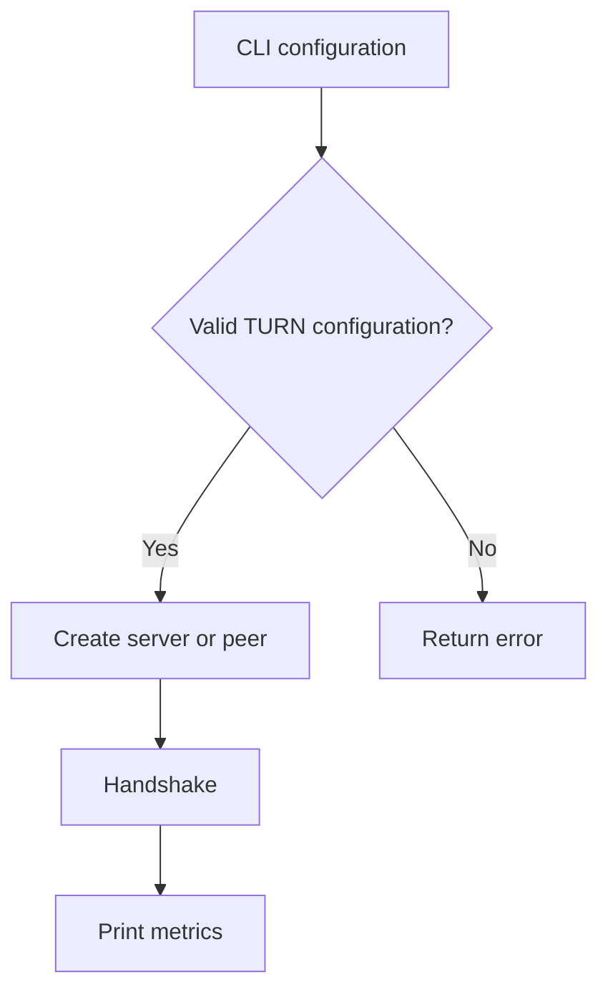

# TURN and metrics

## Purpose
Configure NAT traversal servers and report connection metrics.

## User stories
As an operator, I want relay support and handshake counters for a local run.

## Functional requirements
- FR-ops-existing-1 — TURN URI parsing produces Pion ICE server configuration.
- FR-ops-existing-2 — The optional self-hosted UDP server answers STUN requests.
- FR-ops-existing-3 — Configured TURN credentials enable relay allocations.
- FR-ops-existing-4 — Peer metrics report attempts, outcomes, candidates, and handshake latency.

## User flows

1. Configure TURN credentials if relay support is needed.
2. Start the peer.
3. Inspect the metrics after the run.

## Screens & states
`serve --turn-server ADDR` optionally starts TURN. `--metrics-addr` exposes /metrics.
Peer `--metrics` prints Prometheus text at exit. Empty counters show zero.

## Behaviour rules
Username and password must appear together. Wildcard TURN binds require turn-external.
The server binds udp4. AuthHandler derives a key from username, realm, and password.
The metrics HTTP endpoint uses a separate collector that the DNS server never updates.

## Data touched
TURN Config contains Addr, Realm, Username, Password, ExternalAddr. Metrics holds locked counters and a candidate map.
No persisted metrics or credentials exist in the repository.

## Interfaces
See `internal/turn/turn.go`, `internal/turnserver/turnserver.go`, and `internal/metrics/metrics.go`.
External dependency: [Pion TURN v5.1.3](https://pkg.go.dev/github.com/pion/turn/v5@v5.1.3).
TURN GenerateAuthKey implements the configured authentication key derivation.
`GET /metrics` returns Prometheus text through MetricsHandler.

## Edge cases & failures
Metrics.RecordCandidate panics for a zero-value Metrics because its map is nil.
Arbitrary candidate strings can produce invalid metric names.
The turnserver comments call credentials short-term; the implementation derives a realm-based long-term key.

## Acceptance criteria
- [ ] FR-ops-existing-1: URI tests reject malformed servers.
- [ ] FR-ops-existing-2: STUN tests observe a mapped address.
- [ ] FR-ops-existing-3: Authenticated TURN tests allocate a relay.
- [ ] FR-ops-existing-4: Metric tests report the expected values.

## Out of scope
No browser interface or media call support.

## Open questions
None.
