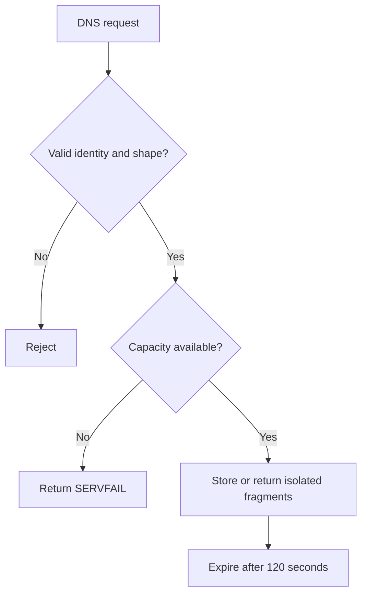

# DNS isolation and resource limits

## Purpose
Repair the DNS transport before any public listener becomes available.

## User stories
As an operator, I want bounded isolated rooms so that one request cannot corrupt another exchange.

## Functional requirements
- FR-dns-repairs-1 — The server includes canonical zone in every storage key.
- FR-dns-repairs-2 — The server accepts only one IN TXT question per request.
- FR-dns-repairs-3 — The server expires fragment entries after 120 seconds.
- FR-dns-repairs-4 — The server limits retained payloads to 16 MiB.
- FR-dns-repairs-5 — Poll rejects fragments outside the requested identity.
- FR-dns-repairs-6 — Publish stops before another exchange after context cancellation.

## User flows

1. Validate the request.
2. Check the storage capacity.
3. Store or return fragments within the requested identity.
4. Expire retained fragments.

## Screens & states
DNS clients receive protocol errors. CLI stderr identifies validation, capacity, expiry, or cancellation failures.
No browser screen applies.

[Terminal mockup](../mockups/06-dns-repairs.html). The mockup illustrates intent. Requirements define the contract.

## Behaviour rules
Canonicalize DNS names to lowercase without a trailing dot before comparison.
Require a single room label with at most 63 octets. Enforce the 255-octet DNS wire-name limit.
Reject invalid Kind values, inconsistent totals, and conflicting duplicates. Identical duplicate fragments remain idempotent.
Limit one message to 16 KiB before fragmentation.
Also reject fragment totals whose worst-case poll response exceeds 60 KiB.
Calculate the response budget from the canonical zone, room, and fragment total before retention.
Long names can reduce the effective message limit. Report that limit rather than retaining an unretrievable message. Limit active room/kind keys to 1024.
Use a background expiry sweep at one-second intervals. Stop the sweep when the server stops.
Bound metadata through the key count and per-message fragment limit. Configure lower limits in deterministic tests.

## Data touched
Extend the DNS key with zone. Track creation time and retained bytes per key.
No migration applies because the store is ephemeral. Reject a live conflicting message until expiry or explicit cleanup.

## Interfaces
Keep existing rendezvous names and sig.Transport signatures.
Malformed requests return FORMERR. Capacity exhaustion returns SERVFAIL. Missing or expired entries return NXDOMAIN.
Reject unsupported types/classes without mutations. A resolver returning nil,nil produces an error rather than a panic.
External protocol implementation: [miekg/dns v1.1.73](https://pkg.go.dev/github.com/miekg/dns@v1.1.73).

## Edge cases & failures
Test mixed-case names, zone collisions, incomplete publication, reordered fragments, and UDP truncation.
After expiry, a new message may reuse the room. Concurrent publications cannot combine fragments from different totals.
Authentication remains a separate server requirement. CRC alone provides no authorization.

## Acceptance criteria
- [x] FR-dns-repairs-1: The same room in two zones cannot read or overwrite the other zone.
- [x] FR-dns-repairs-2: Unsupported questions leave the store unchanged.
- [x] FR-dns-repairs-3: A clock-controlled test removes an idle entry after expiry.
- [x] FR-dns-repairs-4: Capacity tests reject writes without exceeding configured bounds.
- [x] FR-dns-repairs-5: Injected TXT names with another room, kind, or zone return an identity error.
- [x] FR-dns-repairs-6: A cancelled publish performs no further resolver calls.

## Out of scope
No recursive resolver compatibility guarantee or encrypted DNS payload.

## Open questions
None.
