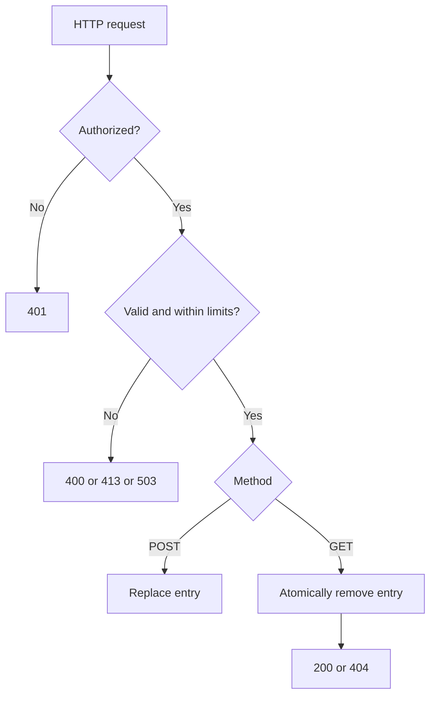

# HTTPS safety and atomic consumption

## Purpose
Bound the fallback handler and repair message consumption.

## User stories
As an operator, I want predictable memory use and reliable one-shot retrieval.

## Functional requirements
- FR-https-repairs-1 — The handler rejects a message above 16 KiB.
- FR-https-repairs-2 — The handler limits retained payloads to 16 MiB.
- FR-https-repairs-3 — The handler consumes an entry atomically.
- FR-https-repairs-4 — The transport rejects non-HTTPS service URLs by default.
- FR-https-repairs-5 — The handler rejects a room outside the shared room grammar.

## User flows

1. Authenticate the request.
2. Validate its identity and size.
3. Store a bounded message or atomically consume an entry.
4. Return the documented status.

## Screens & states
CLI errors explain invalid URL, TLS failure, unauthorized access, oversized message, and server capacity.
Handler errors use stable short response bodies. No browser screen applies.

[Terminal mockup](../mockups/07-https-repairs.html). The mockup illustrates intent. Requirements define the contract.

## Behaviour rules
Authenticate before an expensive sweep or body read. Cap room labels at 63 octets.
Enforce 1024 active entries and the global payload cap under the same lock as replacement.
Read at most limit+1 bytes. Reject excess bytes with 413 before storage.
Keep access-based TTL sweep; capacity limits bound idle retention.
Remove GET entries under lock before network writes. A failed response write still consumes the message.
Permit HTTP only through an explicit test/development option restricted to loopback.
Reject URL userinfo and cross-origin redirects when credentials are present.

## Data touched
Handler entry accounting and atomic lookup/removal. No persistent schema changes.

## Interfaces
Keep /signaling, room, kind, and X-Wingman-Secret.
Return 400 for invalid identity, 401 for invalid credentials, 413 for oversize, 503 for capacity, and 405 for unsupported methods.
Allow header lists GET and POST on 405. GET miss returns 404. Success remains 200.

## Edge cases & failures
Two simultaneous GET requests produce exactly one 200 response.
A GET for an old entry cannot delete a concurrent replacement.
A client that loses the response must begin a new room exchange; automatic exactly-once delivery is out of scope.

## Acceptance criteria
- [x] FR-https-repairs-1: A 16385-byte body returns 413 without retention.
- [x] FR-https-repairs-2: Capacity tests show retained bytes stay within the configured limit.
- [x] FR-https-repairs-3: Concurrent consume tests produce one success without deleting a replacement.
- [x] FR-https-repairs-4: A remote HTTP URL fails before credentials or SDP leave the process.
- [x] FR-https-repairs-5: Malformed and overlong rooms return 400 without storage.

## Out of scope
No durable queue, acknowledgment protocol, account database, or idle sweep goroutine.

## Open questions
None.
