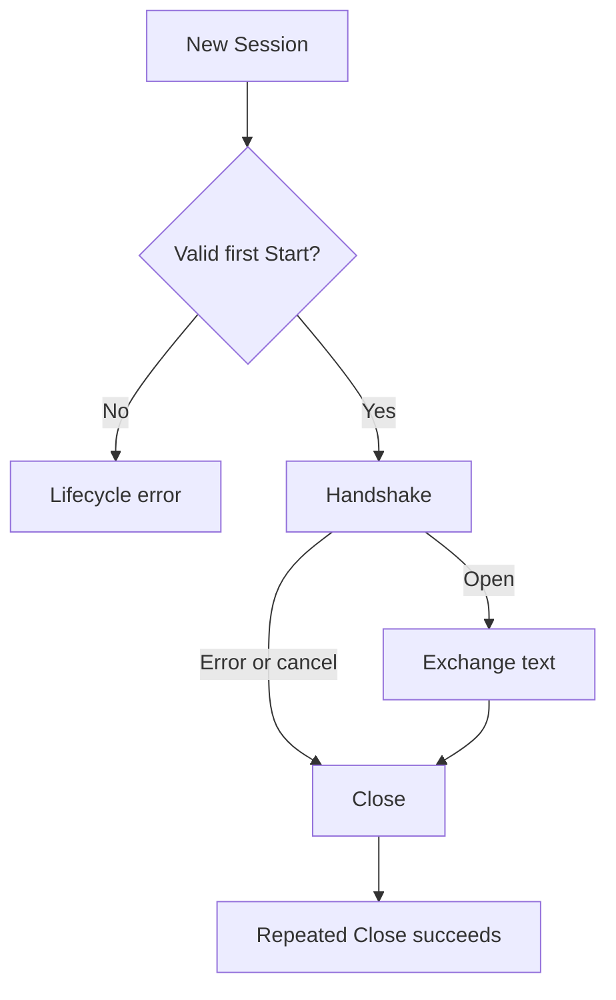

# Peer lifecycle and metric correctness

## Purpose
Make peer startup, cleanup, and diagnostics reliable.

## User stories
As a developer, I want explicit lifecycle errors and safe cleanup so that repeated use does not leak connections.

## Functional requirements
- FR-peer-repairs-1 — Start rejects an unknown role before connection allocation.
- FR-peer-repairs-2 — Start rejects a second invocation on the same Session.
- FR-peer-repairs-3 — Close releases the owned peer connection idempotently.
- FR-peer-repairs-4 — ICE metric callbacks access the collector without a data race.
- FR-peer-repairs-5 — A zero-value Metrics accepts candidate observations.
- FR-peer-repairs-6 — CandidatePriority rejects component values outside 1 through 256.

## User flows

1. Create a Session.
2. Start the handshake once.
3. Exchange text after success.
4. Close the Session on exit.

## Screens & states
CLI reports invalid configuration immediately. Connection errors preserve the original cause.
The peer shows a closed state after cancellation or exit.

[Terminal mockup](../mockups/08-peer-repairs.html). The mockup illustrates intent. Requirements define the contract.

## Behaviour rules
CLI defers Session.Close after creation. Close before Start succeeds without allocation. Start after Close returns an error.
Bound the handshake with a default 30-second timeout. Add a duration option for slower networks.
Synchronize the metrics pointer read with WithMetrics. Restrict candidate names to the known Pion types plus unknown.
If an invalid component reaches CandidatePriority, return a validation error through a revised internal contract.
Confirm secure TURN default ports against pinned Pion URI behavior before changing parser semantics.

## Data touched
Session adds explicit started and closed state. Metrics lazily initializes its candidate map.
No persisted migration applies.

## Interfaces
Add `Session.Close() error`. Keep one-shot Session ownership.
Update internal CandidatePriority callers if validation changes its return shape.
Pion WebRTC v4.2.26: https://pkg.go.dev/github.com/pion/webrtc/v4@v4.2.26.
Pion TURN v5.1.3: https://pkg.go.dev/github.com/pion/turn/v5@v5.1.3.

## Edge cases & failures
Test Close during startup, Close after success, duplicate Start, and cancellation.
Do not treat a later connection-closed callback as the original handshake error.
Candidate utility fixes remain separate from Pion negotiation behavior.

## Acceptance criteria
- [ ] FR-peer-repairs-1: An invalid role returns immediately without creating a connection.
- [ ] FR-peer-repairs-2: A repeated Start returns a lifecycle error.
- [ ] FR-peer-repairs-3: Repeated Close calls release resources once.
- [ ] FR-peer-repairs-4: Concurrent collector updates pass the race detector.
- [ ] FR-peer-repairs-5: A zero-value collector renders valid metrics after RecordCandidate.
- [ ] FR-peer-repairs-6: Component 0 and component 257 return validation errors.

## Out of scope
No browser interface or media call support.

## Open questions
None.
