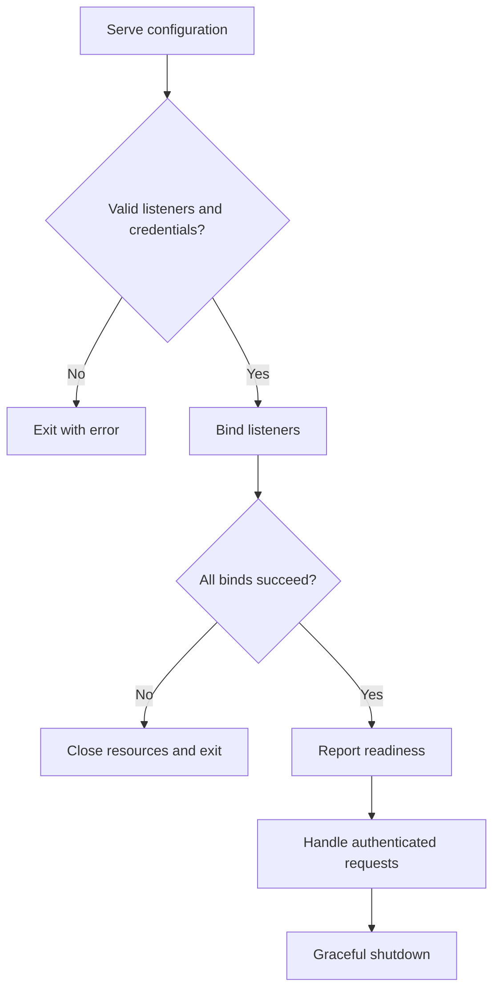

# Deployable servers and authentication

## Purpose
Expose explicit server listeners with authentication and usable operational signals.

## User stories
As an operator, I want configurable DNS and HTTPS services so that peers can run on separate hosts.

## Functional requirements
- FR-server-operations-1 — Serve accepts an explicit DNS listen address.
- FR-server-operations-2 — Serve enforces the configured DNS zone.
- FR-server-operations-3 — The DNS server authenticates queries with configured TSIG keys.
- FR-server-operations-4 — Serve mounts the HTTPS handler behind a configured TLS listener.
- FR-server-operations-5 — Server metrics count signaling activity.
- FR-server-operations-6 — The repository provides a reproducible two-host deployment guide.

## User flows

1. Load listener and credential configuration.
2. Bind every requested listener.
3. Report readiness after successful binds.
4. Process authenticated requests.
5. Close listeners on termination.

## Screens & states
Proposed flags: --listen, --zone, --https-listen, --tls-cert, --tls-key, --signaling-secret-file, --dns-tsig-key-file.
Print actual bound addresses. Show a clear error for an occupied port. Keep secrets out of terminal output.

[Terminal mockup](../mockups/09-server-operations.html). The mockup illustrates intent. Requirements define the contract.

## Behaviour rules
Default DNS listen remains loopback with an ephemeral port. Remote binds require authentication.
Permit an unauthenticated loopback demo through an explicit documented local mode.
Use TSIG HMAC-SHA256 for direct DNS queries. Validate responses on the client. TSIG authenticates; it does not encrypt SDP.
Store TSIG name, algorithm, and base64 secret in a permission-restricted file. Avoid secret-valued command arguments in examples.
Keep HTTPS independent from the metrics listener. Set HTTP header, read, write, and idle timeouts.
Metrics labels use bounded operation and result values; room names never become labels.

## Data touched
Listener configuration, credential file references, and counters. DNS keys remain zone/room/kind.
No account store or durable room storage.

## Interfaces
New DNS settings configure the existing Server. Client key-file configuration signs writes and polls.
HTTPS serves the repaired /signaling contract. /healthz returns 200 after startup; /readyz returns 503 during shutdown.
GET /metrics reports DNS writes, polls, rejections, and retained payload bytes through one shared server collector.
TSIG: [RFC 8945](https://www.rfc-editor.org/rfc/rfc8945). Implementation: [miekg/dns v1.1.73](https://pkg.go.dev/github.com/miekg/dns@v1.1.73).

## Edge cases & failures
Wrong keys, unsigned remote requests, expired signatures, certificate failures, and listener conflicts produce explicit errors.
Bind failures stop the process instead of reporting a healthy service.
Direct UDP and TCP reachability remains necessary. Document this limitation rather than claiming recursive DNS compatibility.

## Acceptance criteria
- [ ] FR-server-operations-1: Two local network namespaces can reach the configured DNS listener.
- [ ] FR-server-operations-2: Queries outside the configured zone cannot read or mutate storage.
- [ ] FR-server-operations-3: Wrong-key and unsigned requests cannot access an authenticated DNS listener.
- [ ] FR-server-operations-4: A TLS client completes a signaling roundtrip against the bundled listener.
- [ ] FR-server-operations-5: One write changes the server write counter.
- [ ] FR-server-operations-6: The guide demonstrates two peers, cancellation, firewall ports, and TURN fallback.

## Out of scope
No cloud provisioning, ACME automation, browser UI, recursive DNS tunneling, or automatic firewall modification.

## Open questions
None.
