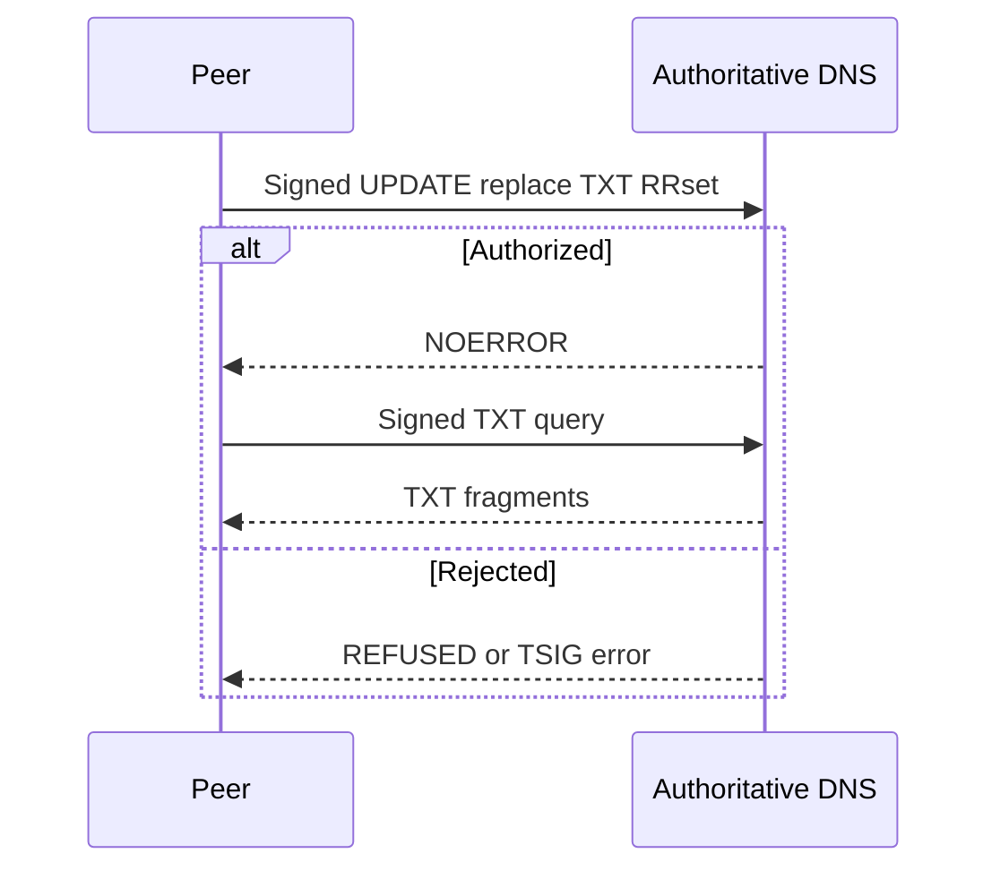

# RFC 2136 DynUpdate transport

## Purpose
Implement the advertised dynamic-update backend against a real authoritative DNS service.

## User stories
As an operator, I want standard authenticated DNS updates so that Wingman can use my existing authoritative server.

## Functional requirements
- FR-dynupdate-1 — The CLI selects DynUpdate through --signaling dynupdate.
- FR-dynupdate-2 — Publish replaces one TXT RRset in one authenticated UPDATE.
- FR-dynupdate-3 — Poll reconstructs the message from the TXT RRset.
- FR-dynupdate-4 — DynUpdate rejects unauthenticated configuration.
- FR-dynupdate-5 — A cleanup command deletes the selected room RRsets.
- FR-dynupdate-6 — Integration tests complete the exchange against BIND.

## User flows

1. Configure the authoritative address and zone.
2. Load the TSIG key file.
3. Publish a complete TXT RRset.
4. Poll the other role.
5. Delete room RRsets after the exchange.

## Screens & states
Proposed options: --signaling dynupdate --addr HOST:PORT --zone ZONE --dns-tsig-key-file PATH.
`wingman cleanup` requires room, zone, address, and the same key file.
Print update rejection, signature failure, timeout, or cleanup outcome without secrets.

[Terminal mockup](../mockups/10-dynupdate.html). The mockup illustrates intent. Requirements define the contract.

## Behaviour rules
Owner name is `<room>.<kind>.sig.<zone>.` Each TXT record contains `<seq>-<total>:<payload>`.
Payload reuses the existing base32 fragment bytes and final CRC trailer. RRset order has no meaning.
Publish sends RemoveRRset then Insert within one UPDATE over TCP. The replacement is atomic under RFC 2136.
Cap decoded messages at 16 KiB. Check packed UPDATE and query-response sizes before sending.
Set record TTL to one second. TTL controls cache retention; it does not delete authoritative records.
Use fresh random room names for each exchange. The guide requires explicit cleanup after interrupted runs.
Attempt role-specific cleanup after successful consumption. Keep the explicit cleanup command for orphaned records.
Scope server update permissions to the signaling subtree. Peers trust the configured authoritative server.

## Data touched
External TXT RRsets only. No use of the custom DNS fragment store.
Cleanup removes offer and answer RRsets within the selected room; it leaves other names unchanged.

## Interfaces
Implement sig.Transport with Publish and Poll. Expose cleanup separately from the two-method transport interface.
Verify NOERROR and valid TSIG on replies. Poll retries NXDOMAIN or an empty answer until context expiry.
Return other rcodes as typed errors. Use context-aware exchanges and bounded retries.
Verified references, retrieved 2026-11-04:
- [miekg/dns v1.1.73](https://pkg.go.dev/github.com/miekg/dns@v1.1.73): SetUpdate, RemoveRRset, Insert, SetTsig, Client.TsigSecret.
- [RFC 2136](https://www.rfc-editor.org/rfc/rfc2136): atomic UPDATE and RRset operations.
- [RFC 8945](https://www.rfc-editor.org/rfc/rfc8945): TSIG authentication.
Pin the BIND test image by version and digest during implementation. Read that version’s update-policy documentation first.

## Edge cases & failures
Test stale RRset replacement, shuffled records, wrong zone, invalid signature, refused update, oversize data, and cancellation.
A missing TCP route fails explicitly. There is no silent fallback to write-over-query.
An interrupted exchange can leave authoritative records until cleanup. Record this operational responsibility in the guide.

## Acceptance criteria
- [ ] FR-dynupdate-1: CLI parsing constructs the DynUpdate transport.
- [ ] FR-dynupdate-2: A replacement of a longer message leaves no stale fragments.
- [ ] FR-dynupdate-3: A shuffled TXT answer reconstructs identical bytes.
- [ ] FR-dynupdate-4: A missing key fails before any UPDATE.
- [ ] FR-dynupdate-5: Cleanup removes only the selected room records.
- [ ] FR-dynupdate-6: A pinned BIND fixture completes a real offer/answer exchange.

## Out of scope
No provider-specific A/AAAA dynamic DNS API, DNS hosting signup, DNSSEC provisioning, or public authoritative server mutation during CI.

## Open questions
None.
