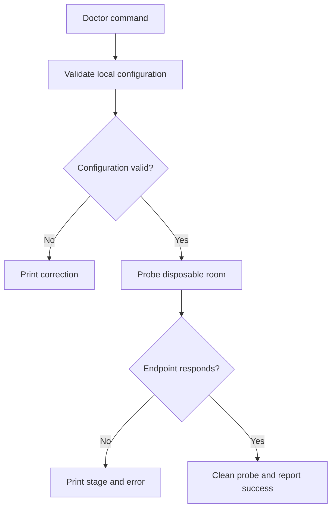

# Diagnostics and network verification

## Purpose
Make failures understandable and prove the main network paths.

## User stories
As an experimenter, I want a reproducible demo. As an operator, I want actionable connection diagnostics.

## Functional requirements
- FR-diagnostics-1 — A doctor command checks the selected signaling endpoint.
- FR-diagnostics-2 — Peers report the selected candidate pair type after connection.
- FR-diagnostics-3 — An opt-in test suite exercises relay-only WebRTC transfer.
- FR-diagnostics-4 — The demo script exchanges a known message through two CLI peers.
- FR-diagnostics-5 — Logs redact credential and SDP content by default.

## User flows

1. Run doctor with the intended transport.
2. Inspect configuration and endpoint results.
3. Run the two-peer demo.
4. Inspect the selected candidate type.

## Screens & states
`wingman doctor` prints stage, result, duration, and a suggested correction.
An optional --json mode emits versioned structured results. Exit 0 means every requested check passes.
A relay result says relay; it does not claim direct connectivity. The mockup shows the proposed terminal result contract.

[Terminal mockup](../mockups/11-diagnostics.html). The mockup illustrates intent. Requirements define the contract.

## Behaviour rules
Doctor mutates only a random disposable probe room. Print this behavior in help.
Use a five-second probe deadline by default. Accept an explicit timeout override.
Report DNS UDP, DNS TCP, TLS, auth, publication, and retrieval as separate applicable stages.
The doctor checks configured services; it cannot prove every NAT topology.
Provide an offline loopback suite and an opt-in Linux namespace suite. No external public STUN dependency in mandatory CI.

## Data touched
Probe rooms and bounded result records. Delete probe data when the selected backend supports cleanup.
Failure-path DNS records otherwise expire through the repaired store.

## Interfaces
Add doctor and a versioned JSON result schema with schema_version, transport, checks, and success.
Each check includes name, success, duration_ms, and error_code.
Use Pion stats to obtain the selected pair, verified against [WebRTC v4.2.26](https://pkg.go.dev/github.com/pion/webrtc/v4@v4.2.26) during implementation.
Do not infer the selected route from gathered candidate counts.

## Edge cases & failures
Test refused authentication, blocked TCP fallback, expired deadline, and unavailable relay.
A skipped optional network test reports its prerequisite. It cannot count as a pass.
The demo uses temporary credentials and removes temporary files on exit.

## Acceptance criteria
- [x] FR-diagnostics-1: Doctor detects an unreachable endpoint with a nonzero exit.
- [x] FR-diagnostics-2: A relay-only test reports relay after successful message transfer.
- [x] FR-diagnostics-3: The namespace suite transfers data through the local TURN server.
- [x] FR-diagnostics-4: A fresh clone runs the demo without manual SDP exchange.
- [x] FR-diagnostics-5: Captured logs contain no test password, secret, or raw SDP.

## Out of scope
No file transfer, port forwarding, video calls, anonymity guarantees, or automatic NAT/router configuration.

## Open questions
None.
