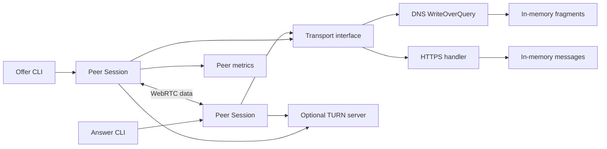
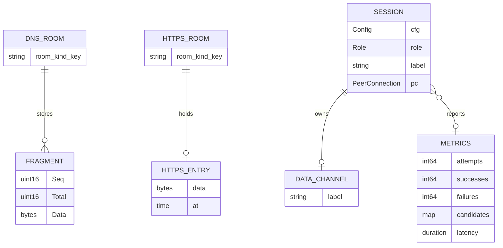

# Wingman

## Overview
Wingman exchanges WebRTC session descriptions through DNS or an HTTP fallback. After the handshake, WebRTC carries the peer data directly or through TURN.

The project serves developers, operators, end users, and people who experiment with network protocols. This inheritance records the existing implementation before repairs.

The operator requests fixes first, followed by useful additions. The roadmap implements the advertised RFC 2136 DynUpdate backend.

## Terms

| Term | Part of speech | Meaning in this project | Do not use |
|---|---|---|---|
| peer | noun | One participant in a WebRTC connection | node |
| room | noun | A single-label rendezvous identifier shared by peers | channel ID |
| zone | noun | The configured DNS suffix for signaling names | domain namespace |
| kind | noun | The offer or answer direction | message role |
| fragment | noun | A sequence-numbered portion of a message | packet chunk |
| message | noun | Serialized SDP bytes sent through a transport | document |
| SDP | noun | Session Description Protocol data used by WebRTC | session blob |
| DNS | noun | Domain Name System | name network |
| ICE | noun | Interactive Connectivity Establishment | NAT engine |
| STUN | noun | Session Traversal Utilities for NAT | reflection service |
| TURN | noun | Traversal Using Relays around NAT | proxy tunnel |
| NAT | noun | Network Address Translation | address firewall |
| TLS | noun | Transport Layer Security | SSL |
| TSIG | noun | DNS transaction signature with a shared secret | encrypted DNS |
| RRset | noun | DNS records with the same owner, class, and type | record group |
| SOA | noun | DNS Start of Authority record | zone header |
| TXT | noun | DNS text record type | text packet |
| CRC32 | noun | The existing 32-bit corruption checksum | authentication code |
| URI | noun | Uniform Resource Identifier for a STUN or TURN service | server string |
| CLI | noun | Command-line interface | app screen |
| CI | noun | Continuous integration checks on GitHub | deploy service |
| Session | noun | The internal peer object that owns one connection | reusable client |
| transport | noun | Publish and Poll implementation | backend channel |
| WriteOverQuery | noun | The custom fragment query transport | DNS UPDATE |
| DynUpdate | noun | Planned RFC 2136 transport | provider dyndns API |
| candidate | noun | An address offered for ICE negotiation | selected route |
| selected pair | noun | The candidate pair that carries peer traffic | gathered pair |
| publish | verb | Store a signaling message through a transport | broadcast |
| poll | verb | Request a signaling message until available | subscribe |
| cleanup | noun | Explicit removal of room records | cache expiry |
| operator | noun | The person who configures a signaling service | account admin |
| epic | noun | One independently mergeable batch of planned work | phase ticket |
| built | adjective | Observed in code, including documented limitations | verified production-ready |

## Goals
- Repair isolated storage, resource limits, and message consumption before remote deployment.
- Preserve successful WebRTC message exchange through every supported transport.
- Maintain at least 95% aggregate statement coverage.
- Pass concurrency checks for the documented concurrent APIs.
- Complete an authenticated RFC 2136 exchange against a real authoritative test server.
- Provide a reproducible local demo and actionable diagnostics.

## Non-goals
- Browser UI, video calls, file transfer, and port forwarding are outside this roadmap.
- DNS does not carry application data after the handshake.
- This release does not guarantee access through every restrictive network.
- The plan does not provision paid services or operate a public relay.

## Users & personas
| Persona | Need | Authority |
|---|---|---|
| Developer | Reproducible tests and clear module contracts | Edit code and run local fixtures |
| Operator | Authenticated listeners and bounded resources | Configure services and credentials |
| End user | Two-peer text exchange and useful errors | Use configured endpoints and a room |
| Experimenter | Simple demos and diagnostic output | Run disposable local rooms |

## Feature map
| Feature | Record | State | Epic |
|---|---|---|---|
| Foundation gaps | [foundation](features/00-foundation.md) | built | Epic 0: Foundation |
| Signal framing and names | [framing](features/01-framing.md) | built | Existing behavior |
| DNS query transport | [dns-existing](features/02-dns-existing.md) | built | Existing behavior |
| Peer handshake and chat | [peer-existing](features/03-peer-existing.md) | built | Existing behavior |
| HTTPS fallback transport | [https-existing](features/04-https-existing.md) | built | Existing behavior |
| TURN and metrics | [ops-existing](features/05-ops-existing.md) | built | Existing behavior |
| DNS isolation and resource limits | [dns-repairs](features/06-dns-repairs.md) | built | Epic 1: DNS repairs |
| HTTPS safety and atomic consumption | [https-repairs](features/07-https-repairs.md) | built | Epic 2: HTTPS repairs |
| Peer lifecycle and metric correctness | [peer-repairs](features/08-peer-repairs.md) | built | Epic 3: Peer repairs |
| Deployable servers and authentication | [server-operations](features/09-server-operations.md) | issued | Epic 4: Server operations |
| RFC 2136 DynUpdate transport | [dynupdate](features/10-dynupdate.md) | issued | Epic 5: DynUpdate |
| Diagnostics and network verification | [diagnostics](features/11-diagnostics.md) | issued | Epic 6: Diagnostics |

Each planned feature links its own terminal mockup. Built features point to source files and have no mockups.

## Architecture & stack


This diagram describes the existing code. DynUpdate and configurable remote listeners remain planned.

Go 1.25.0 defines the module. Source lives under cmd/ and internal/. The CLI supplies the only user interface.

Pion WebRTC owns negotiation and data channels. The local internal/ice package supplies separate candidate utilities.

The server uses in-memory maps. No database, filesystem state, migration, or hosted deployment exists.

Verified dependency documentation, retrieved 2026-11-04:
- [miekg/dns v1.1.73](https://pkg.go.dev/github.com/miekg/dns@v1.1.73) supplies DNS messages, UDP/TCP exchanges, and TSIG APIs.
- [Pion WebRTC v4.2.26](https://pkg.go.dev/github.com/pion/webrtc/v4@v4.2.26) supplies peer connections and data channels.
- [Pion TURN v5.1.3](https://pkg.go.dev/github.com/pion/turn/v5@v5.1.3) supplies the optional relay server.

The existing stack avoids a separate runtime and persistent database. These are reconstructed choices, rather than claims about the original author's intent.

## Data model


The diagram shows logical ownership in memory, not relational tables. There are no foreign keys or database writes.

DNS_ROOM uses room/kind as its current key. FRAGMENT uses Seq within that key. Publication overwrites the same sequence.

HTTPS_ROOM uses room/kind as its current key. HTTPS_ENTRY includes the body and publication time. GET attempts removal after response delivery.

Session owns its peer connection and data channel. Candidate callbacks update an optional Metrics object.

Metrics uses a mutex for counters. Its constructor initializes the candidate map; its zero value currently lacks that initialization.

Planned features state each field or lifecycle change. They do not retroactively change this observed model.

## Cross-cutting concerns
The DNS endpoint has no authentication today. HTTPS optionally checks a shared secret. TURN uses configured username and realm-based password authentication.

CRC32 detects corruption. It does not prove peer identity. Peers currently trust the signaling service with SDP and remote peer selection.

The roadmap adds authenticated direct DNS transactions. It does not promise SDP confidentiality over DNS or protection against a malicious authorized service.

Go errors carry failures to CLI stderr. Planned errors identify the failed stage without secret values or raw SDP.

The CLI uses English text. No browser accessibility surface or translation framework exists. Structured diagnostics support automation without parsing prose.

Resource bounds belong to the transport services. Planned limits include 16 KiB messages, 1024 keys, and 16 MiB retained payloads.

## Environments & config
No environment-variable names occur in the current application configuration. CLI flags supply settings.

Current DNS defaults use example.com and loopback addresses. Library polling defaults to 250 ms; CLI polling uses 50 ms.

Local smoke path after server repairs:
```sh
go build -o /tmp/wingman ./cmd/wingman
/tmp/wingman serve --local-demo
/tmp/wingman offer --addr 127.0.0.1:PORT --room demo
/tmp/wingman answer --addr 127.0.0.1:PORT --room demo
```
Replace PORT with the port printed by serve. Run each long-lived command in a separate terminal.

The local smoke path uses no fixed seed data. Each test creates its own room or fixture.

The roadmap uses secret files for new credentials. Store only file paths and variable names in public documentation.

No deployed domain or host appears in the repository inventory. The initial target is a self-hosted CLI service with a deployment guide.

## Testing strategy
The baseline command is `bash scripts/coverage.sh`. It runs go mod tidy, go vet, package tests, and the aggregate coverage gate.

The inherited baseline passes with 96.3% aggregate statement coverage.
The audit race command fails in peer tests because StubTransport accesses its map without synchronization.
Foundation repairs that shared test transport before it enables the new CI race gate. Some individual packages remain below 95%; the gate measures the aggregate.

The audit uses a temporary writable GOCACHE because the restricted session cannot write the normal cache.

Unit tests cover framing, names, URI validation, metrics, and deterministic failure paths.

Existing integration tests exercise local DNS, TCP fallback, peer channels, HTTP handlers, and TURN allocations.

Every repair adds a regression test for its observed failure. Concurrency changes require race tests.

Foundation adds format and complexity checks. Later epics add TLS, authenticated DNS, BIND, and optional namespace tests.

Completion requires the relevant regression tests, the verification command, and the documented smoke path where behavior changes.

## Epics
| Epic | Scope | Depends on | Size | Exit criterion |
|---|---|---|---|---|
| Epic 0: Foundation | Missing checks and release guide | None | 5 focused tasks | Reproducible verification |
| Epic 1: DNS repairs | Isolation, bounds, identity checks | Foundation | 5 focused tasks | Negative tests preserve isolation |
| Epic 2: HTTPS repairs | Limits, atomic consume, secure URLs | Foundation | 4 focused tasks | Concurrency and limit tests pass |
| Epic 3: Peer repairs | Lifecycle, metrics, candidate validation | Foundation | 5 focused tasks | Resource cleanup and race checks pass |
| Epic 4: Server operations | Remote listeners, zone enforcement, auth, telemetry | DNS, HTTPS, Peer repairs | 6 focused tasks | Two-host authenticated smoke path |
| Epic 5: DynUpdate | Standard UPDATE transport and cleanup | Server operations | 5 focused tasks | BIND exchange and cleanup pass |
| Epic 6: Diagnostics | Doctor, selected pair, demo, relay tests | DynUpdate | 5 focused tasks | Reproducible diagnostics and demos |

Each epic produces one batch PR into dev. Existing behavior records produce no tracker issues.

## Milestones
1. Foundation establishes the verification gate.
2. DNS, HTTPS, and peer repairs establish the reliable local baseline.
3. Server operations establishes authenticated remote services.
4. DynUpdate establishes the third advertised transport.
5. Diagnostics establishes the reviewed end-user path.

Every milestone leaves tests green. The operator approves each promotion from dev to main separately.

## Assumptions
- The public repository also holds specs, issues, and pull requests, as the operator requested.
- The project retains Go and the current libraries unless a repair demonstrates a specific incompatibility.
- “Implement the dyndns” means the advertised RFC 2136 DynUpdate backend, rather than a provider-specific address update service.
- Self-hosted services and CLI users define this roadmap. No hosting account or domain is required to approve it.
- A browser interface can follow a later explicit product decision.
- Fresh room names identify separate exchanges. Concurrent publishers for the same role and room are unsupported.
- The scaffold targets Codex. No Claude configuration exists or is needed for the current request.

## Risks & open questions
- The race detector reports unsynchronized StubTransport map access in peer tests. Foundation repairs the shared transport before enforcing this gate.
- README advertises DynUpdate, but no implementation exists. Epic 5 supplies it.
- README claims a configured SOA negative-cache policy. The server emits no SOA. Document direct-query scope in Epic 4.
- README calls main protected. GitHub reports main and dev unprotected. The release guide proposes protection as an operator action.
- serve --zone only changes printed text today. Epic 4 makes the setting authoritative.
- DNS room keys omit zone. The server retains fragments without expiry or capacity limits. Epic 1 repairs these defects.
- HTTPS POST reads an unlimited body. Its TTL sweep does not create a memory bound. Epic 2 repairs resource limits.
- HTTPS GET releases its lock before deletion. A GET can duplicate consumption or delete a replacement. Epic 2 repairs this race.
- HTTP URLs can carry the secret and SDP without TLS. Epic 2 rejects unsafe remote URLs.
- Metrics claims a usable zero value, but RecordCandidate panics without the constructor. Epic 3 repairs this contract.
- The server metrics collector never receives DNS activity. Epic 4 wires operational counters.
- TURN comments call credentials short-term; the realm-based key implementation uses long-term authentication. Correct comments with the relevant implementation work.
- The ICE candidate utility produces port-zero address inventory. It does not provide dialable Pion candidates. Preserve that distinction in documentation.
- Unknown Session roles lack immediate errors. Session lacks explicit successful-connection cleanup. Epic 3 defines lifecycle behavior.
- WithMetrics and the ICE callback use inconsistent locking. Treat a targeted regression test as necessary evidence before the repair.
- A real DNS server retains dynamic records after cache TTL expiry. Epic 5 provides cleanup and documents interrupted exchanges.
- TSIG proves knowledge of a shared key. It does not encrypt DNS payloads or protect against an authorized malicious peer.
- The pinned URI parser comparison confirms that a portless turns URI uses 5349. Explicit ports remain unchanged. See [#90](https://github.com/Crank-Git/wingman/issues/90).
- No product-critical question remains. The operator approved the additions and scaffold on 2026-11-04.

## Changelog
- 2026-11-04: Add restricted TURN password file inputs and omit credentials from startup hints so deployment examples meet the approved credential rule.
- 2026-11-04: Build TSIG before remote listeners. Use an explicit local demo mode, restricted credential files, and bounded HTTP timeouts. Record the configuration details in Epic 4 member plans. Verify namespace reachability in an isolated Linux container before sub-merge.
- 2026-11-04: Group the workflow context repair and the failing chat test into a CI recovery batch before repair promotion.
- 2026-11-04: Draft inheritance review. Record five existing feature sets and seven planned feature sets. Preserve public visibility and dev-and-live releases.
- 2026-11-04: The operator approves the spec and scaffold. Apply the reviewed files and retain the known defects as planned work.

## Issue map

GitHub issues cover the seven planned feature sets. The five built feature sets create no issues.

| Epic | Feature | Epic issue | Sub-issues |
|---|---|---|---|
| Epic 0: Foundation | foundation | [#10](https://github.com/Crank-Git/wingman/issues/10) | [#11](https://github.com/Crank-Git/wingman/issues/11), [#12](https://github.com/Crank-Git/wingman/issues/12), [#13](https://github.com/Crank-Git/wingman/issues/13), [#14](https://github.com/Crank-Git/wingman/issues/14), [#15](https://github.com/Crank-Git/wingman/issues/15) |
| Epic 1: DNS repairs | dns-repairs | [#16](https://github.com/Crank-Git/wingman/issues/16) | [#17](https://github.com/Crank-Git/wingman/issues/17), [#18](https://github.com/Crank-Git/wingman/issues/18), [#19](https://github.com/Crank-Git/wingman/issues/19), [#20](https://github.com/Crank-Git/wingman/issues/20), [#21](https://github.com/Crank-Git/wingman/issues/21) |
| Epic 2: HTTPS repairs | https-repairs | [#22](https://github.com/Crank-Git/wingman/issues/22) | [#23](https://github.com/Crank-Git/wingman/issues/23), [#24](https://github.com/Crank-Git/wingman/issues/24), [#25](https://github.com/Crank-Git/wingman/issues/25), [#26](https://github.com/Crank-Git/wingman/issues/26) |
| Epic 3: Peer repairs | peer-repairs | [#27](https://github.com/Crank-Git/wingman/issues/27) | [#28](https://github.com/Crank-Git/wingman/issues/28), [#29](https://github.com/Crank-Git/wingman/issues/29), [#30](https://github.com/Crank-Git/wingman/issues/30), [#31](https://github.com/Crank-Git/wingman/issues/31), [#32](https://github.com/Crank-Git/wingman/issues/32) |
| Epic 4: Server operations | server-operations | [#33](https://github.com/Crank-Git/wingman/issues/33) | [#34](https://github.com/Crank-Git/wingman/issues/34), [#35](https://github.com/Crank-Git/wingman/issues/35), [#36](https://github.com/Crank-Git/wingman/issues/36), [#37](https://github.com/Crank-Git/wingman/issues/37), [#38](https://github.com/Crank-Git/wingman/issues/38), [#39](https://github.com/Crank-Git/wingman/issues/39) |
| Epic 5: DynUpdate | dynupdate | [#40](https://github.com/Crank-Git/wingman/issues/40) | [#41](https://github.com/Crank-Git/wingman/issues/41), [#42](https://github.com/Crank-Git/wingman/issues/42), [#43](https://github.com/Crank-Git/wingman/issues/43), [#44](https://github.com/Crank-Git/wingman/issues/44), [#45](https://github.com/Crank-Git/wingman/issues/45) |
| Epic 6: Diagnostics | diagnostics | [#46](https://github.com/Crank-Git/wingman/issues/46) | [#47](https://github.com/Crank-Git/wingman/issues/47), [#48](https://github.com/Crank-Git/wingman/issues/48), [#49](https://github.com/Crank-Git/wingman/issues/49), [#50](https://github.com/Crank-Git/wingman/issues/50), [#51](https://github.com/Crank-Git/wingman/issues/51) |

### Requirement coverage

| Requirement | Sub-issues |
|---|---|
| FR-foundation-1 | [#14](https://github.com/Crank-Git/wingman/issues/14) |
| FR-foundation-2 | [#13](https://github.com/Crank-Git/wingman/issues/13) |
| FR-foundation-3 | [#13](https://github.com/Crank-Git/wingman/issues/13) |
| FR-foundation-4 | [#12](https://github.com/Crank-Git/wingman/issues/12) |
| FR-foundation-5 | [#15](https://github.com/Crank-Git/wingman/issues/15) |
| FR-foundation-6 | [#11](https://github.com/Crank-Git/wingman/issues/11) |
| FR-dns-repairs-1 | [#17](https://github.com/Crank-Git/wingman/issues/17) |
| FR-dns-repairs-2 | [#17](https://github.com/Crank-Git/wingman/issues/17) |
| FR-dns-repairs-3 | [#18](https://github.com/Crank-Git/wingman/issues/18) |
| FR-dns-repairs-4 | [#19](https://github.com/Crank-Git/wingman/issues/19) |
| FR-dns-repairs-5 | [#20](https://github.com/Crank-Git/wingman/issues/20) |
| FR-dns-repairs-6 | [#21](https://github.com/Crank-Git/wingman/issues/21) |
| FR-https-repairs-1 | [#23](https://github.com/Crank-Git/wingman/issues/23) |
| FR-https-repairs-2 | [#24](https://github.com/Crank-Git/wingman/issues/24) |
| FR-https-repairs-3 | [#25](https://github.com/Crank-Git/wingman/issues/25) |
| FR-https-repairs-4 | [#26](https://github.com/Crank-Git/wingman/issues/26) |
| FR-https-repairs-5 | [#23](https://github.com/Crank-Git/wingman/issues/23) |
| FR-peer-repairs-1 | [#28](https://github.com/Crank-Git/wingman/issues/28) |
| FR-peer-repairs-2 | [#28](https://github.com/Crank-Git/wingman/issues/28) |
| FR-peer-repairs-3 | [#29](https://github.com/Crank-Git/wingman/issues/29), [#32](https://github.com/Crank-Git/wingman/issues/32) |
| FR-peer-repairs-4 | [#30](https://github.com/Crank-Git/wingman/issues/30) |
| FR-peer-repairs-5 | [#30](https://github.com/Crank-Git/wingman/issues/30) |
| FR-peer-repairs-6 | [#31](https://github.com/Crank-Git/wingman/issues/31) |
| FR-server-operations-1 | [#34](https://github.com/Crank-Git/wingman/issues/34), [#37](https://github.com/Crank-Git/wingman/issues/37) |
| FR-server-operations-2 | [#34](https://github.com/Crank-Git/wingman/issues/34) |
| FR-server-operations-3 | [#35](https://github.com/Crank-Git/wingman/issues/35) |
| FR-server-operations-4 | [#36](https://github.com/Crank-Git/wingman/issues/36), [#37](https://github.com/Crank-Git/wingman/issues/37) |
| FR-server-operations-5 | [#38](https://github.com/Crank-Git/wingman/issues/38) |
| FR-server-operations-6 | [#39](https://github.com/Crank-Git/wingman/issues/39) |
| FR-dynupdate-1 | [#41](https://github.com/Crank-Git/wingman/issues/41) |
| FR-dynupdate-2 | [#42](https://github.com/Crank-Git/wingman/issues/42) |
| FR-dynupdate-3 | [#43](https://github.com/Crank-Git/wingman/issues/43) |
| FR-dynupdate-4 | [#41](https://github.com/Crank-Git/wingman/issues/41) |
| FR-dynupdate-5 | [#44](https://github.com/Crank-Git/wingman/issues/44) |
| FR-dynupdate-6 | [#45](https://github.com/Crank-Git/wingman/issues/45) |
| FR-diagnostics-1 | [#47](https://github.com/Crank-Git/wingman/issues/47), [#48](https://github.com/Crank-Git/wingman/issues/48) |
| FR-diagnostics-2 | [#49](https://github.com/Crank-Git/wingman/issues/49) |
| FR-diagnostics-3 | [#50](https://github.com/Crank-Git/wingman/issues/50) |
| FR-diagnostics-4 | [#51](https://github.com/Crank-Git/wingman/issues/51) |
| FR-diagnostics-5 | [#51](https://github.com/Crank-Git/wingman/issues/51) |

### Dependencies

- [#16](https://github.com/Crank-Git/wingman/issues/16) depends on [#10](https://github.com/Crank-Git/wingman/issues/10).
- [#22](https://github.com/Crank-Git/wingman/issues/22) depends on [#10](https://github.com/Crank-Git/wingman/issues/10).
- [#27](https://github.com/Crank-Git/wingman/issues/27) depends on [#10](https://github.com/Crank-Git/wingman/issues/10).
- [#33](https://github.com/Crank-Git/wingman/issues/33) depends on [#16](https://github.com/Crank-Git/wingman/issues/16), [#22](https://github.com/Crank-Git/wingman/issues/22), [#27](https://github.com/Crank-Git/wingman/issues/27).
- [#40](https://github.com/Crank-Git/wingman/issues/40) depends on [#33](https://github.com/Crank-Git/wingman/issues/33).
- [#46](https://github.com/Crank-Git/wingman/issues/46) depends on [#40](https://github.com/Crank-Git/wingman/issues/40).

Sub-issue bodies record dependencies within each epic. GitHub records each child as a native sub-issue.

## Supplemental issues

| Work | Tracking | Members |
|---|---|---|
| CI recovery | [#74](https://github.com/Crank-Git/wingman/issues/74) | [#69](https://github.com/Crank-Git/wingman/issues/69), [#73](https://github.com/Crank-Git/wingman/issues/73) |
| Concurrent coverage profiles | [#16](https://github.com/Crank-Git/wingman/issues/16) | [#62](https://github.com/Crank-Git/wingman/issues/62) |
| Ephemeral DNS port recovery | [#27](https://github.com/Crank-Git/wingman/issues/27) | [#84](https://github.com/Crank-Git/wingman/issues/84) |
| Server deployment repairs | [#33](https://github.com/Crank-Git/wingman/issues/33) | [#90](https://github.com/Crank-Git/wingman/issues/90), [#91](https://github.com/Crank-Git/wingman/issues/91), [#98](https://github.com/Crank-Git/wingman/issues/98) |
